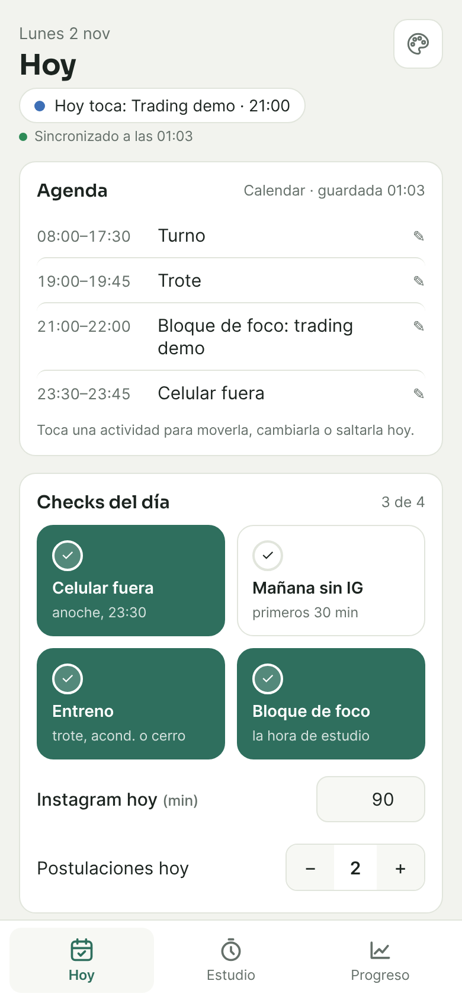
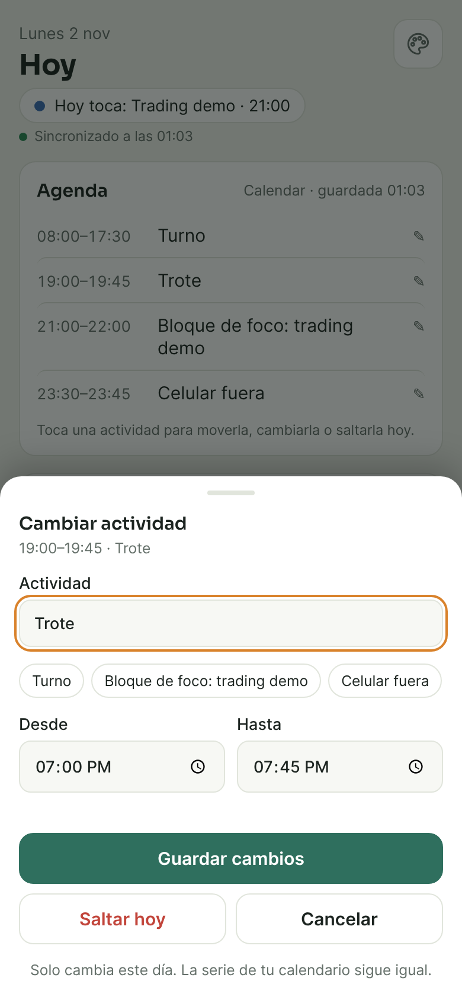
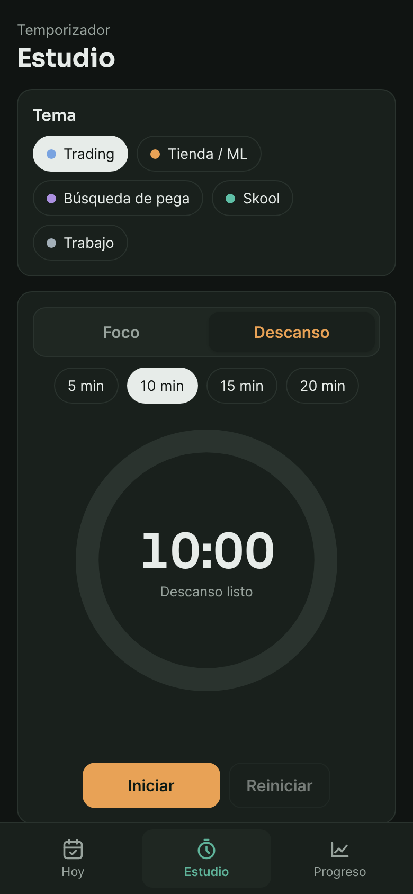
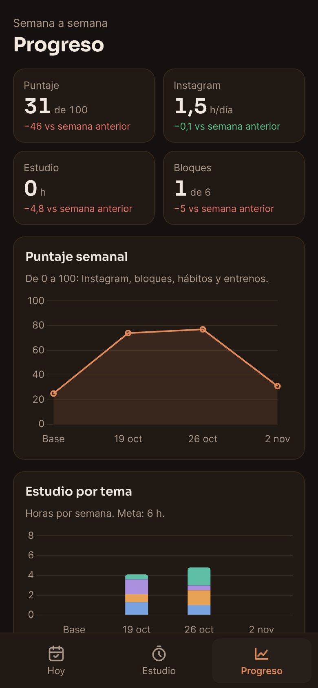
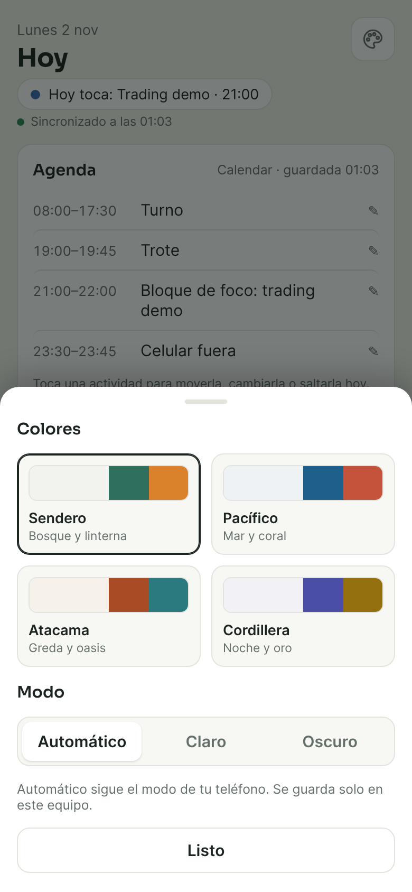
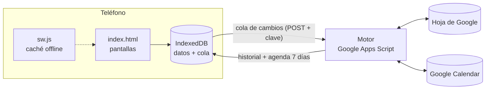

# Predyctor

App de rutina personal para el celular. Tiene checks del día, un temporizador de estudio con descansos y un panel de progreso semana a semana. La agenda viene de Google Calendar. Funciona sin señal y sincroniza sola cuando vuelve la conexión.

La hice para mi propia rutina: trabajo en terreno, muchas veces sin cobertura, y necesitaba algo que no se cayera por eso. Si te sirve, puedes [montar tu propia copia](docs/GUIA-PLANTILLA.md).

**Abrir:** https://victorabarca53-ship-it.github.io/predyctor/ (pide vincular el equipo con la cuenta del dueño)

<p>
  
  
  
  
  
</p>

## Qué hace

- **Hoy:** la agenda de Google Calendar, cuatro checks de hábitos, minutos de Instagram y postulaciones del día, con una racha de los últimos 14 días.
- **Editar mi día:** tocas una actividad y la mueves de hora, la cambias por otra o la saltas. Solo afecta ese día; la serie del calendario queda igual. También funciona sin señal.
- **Temporizador:** pestañas Foco (30, 45 o 60 min) y Descanso (5 a 20 min). El descanso nunca parte solo: lo eliges tú. Al terminar una tanda suena, vibra y deja una alarma en Calendar que suena aunque el teléfono esté bloqueado.
- **Progreso:** puntaje semanal de 0 a 100, horas por tema contra la meta, Instagram por día y un mapa de constancia de 8 semanas.
- **Colores:** cuatro paletas (Sendero, Pacífico, Atacama y Cordillera), cada una con modo claro, oscuro o automático.

## Cómo está armada



- **Primero en el teléfono.** Cada check, sesión de estudio o cambio de agenda se guarda al tiro en IndexedDB y entra a una cola. La pantalla nunca espera a la red.
- **Sincronización con reglas simples.**
  - En los checks diarios gana el cambio más reciente, según su marca de tiempo.
  - Cada sesión de estudio lleva un id, así que reenviarla no la duplica.
  - Los cambios de agenda llevan un `opId` y el motor recuerda los que ya aplicó.
- **El service worker** guarda la app completa, incluidas las fuentes y Chart.js, que van dentro del repo para no depender de CDNs. La navegación pide primero a la red pero no espera más de 3 segundos; si no hay respuesta, abre la copia guardada.
- **El motor** (`motor/Code.gs`) es una app web de Apps Script. Solo responde a peticiones que traen la clave del equipo vinculado. La clave se entrega en una página a la que solo el dueño de la cuenta puede entrar.
- **Las alarmas** son eventos cortos de Calendar con aviso a los 0 minutos. Una PWA no puede programar notificaciones con la app cerrada; Calendar sí, y suena con el teléfono bloqueado.
- **Zona horaria.** Los días se calculan con la zona de la configuración, no con la del calendario ni la del teléfono. Así un evento a las 23:30 no se cambia de día.

## Archivos

| Archivo | Qué es |
|---|---|
| `index.html` | La app: pantallas, datos locales, sincronización y temporizador. Sin frameworks ni build. |
| `config.js` | Lo personal: temas, rotación semanal, metas, línea base y URLs del motor. |
| `sw.js` | Service worker. Hay que subir `CACHE` en cada cambio para que el teléfono descargue la versión nueva. |
| `manifest.webmanifest` | Datos para instalarla como app. |
| `motor/Code.gs` | Motor de plantilla para Apps Script (hoja, agenda, alarmas y edición de agenda). |
| `tests/` | Pruebas del motor con servicios simulados y pruebas de punta a punta con Playwright. |
| `vendor/` | Chart.js 4.4.1 (MIT) y las fuentes Sora e Inter (OFL). |

## Pruebas

```bash
node tests/motor.test.js                          # motor con SpreadsheetApp/CalendarApp simulados
python3 -m http.server 8765 --bind 127.0.0.1      # en otra terminal
node tests/e2e/offline.test.js                    # modo avión, cola y sincronización al volver la señal
node tests/e2e/descanso.test.js                   # Foco / Descanso
node tests/e2e/editar.test.js                     # Editar mi día con y sin señal
node tests/e2e/paletas.test.js                    # paletas y modos
node tests/capturas.js                            # regenera las capturas de este README con datos de demo
```

Las pruebas de punta a punta simulan el motor, así que no tocan ninguna cuenta real. Necesitan `npm i playwright`.

## Usarla tú

La guía paso a paso está en [docs/GUIA-PLANTILLA.md](docs/GUIA-PLANTILLA.md). En resumen:

1. Haz un fork.
2. Crea una hoja de Google y pega el motor.
3. Edita `config.js` con tus temas y tu rotación.
4. Publica con GitHub Pages.

Toma unos 20 minutos y no cuesta nada.

## Licencia

Código bajo [MIT](LICENSE). Chart.js tiene licencia MIT y las fuentes Sora e Inter, licencia SIL Open Font License; sus textos están en `vendor/`.
